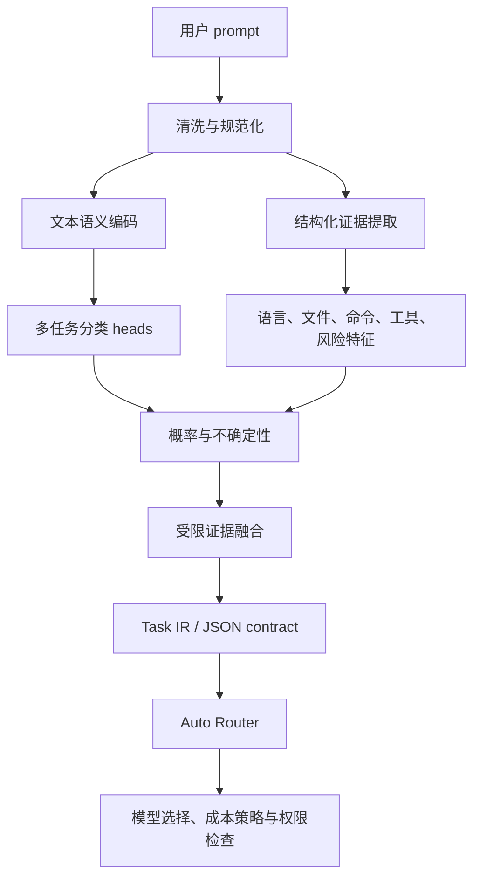
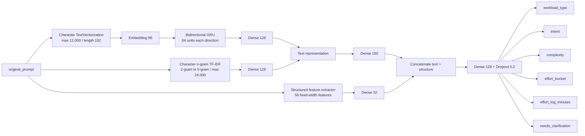

# TrendModel：面向 Auto Router 的轻量级任务分析模型

> 论文式系统设计文档；实现基线：`model_version = 0.3.0`

## 摘要

本文定义 TrendModel 的问题边界、数据流、模型结构和推理算法。TrendModel 的输入是一段用户 prompt，输出是面向 Auto Router 的结构化任务分析，而不是最终答案。系统需要同时判断用户意图、workload 类型、复杂度、粗粒度 effort、是否需要澄清，以及代码、文件、命令、工具和风险等可观测约束。

本文采用“语义表示 + Task AST-like 结构化证据 + Bayesian-style 融合 + Task IR”的分层设计。文本编码器负责理解自然语言整体语义；结构化解析器负责提取代码块、语言、路径、命令、操作和风险等确定性信号；融合层负责组合不同来源的证据并管理不确定性；Task IR 则作为下游 Router 的稳定接口。贝叶斯方法在本系统中不是中文语义理解器，也不是一个独立的训练模型，而是位于分类输出之后的证据融合和置信度管理层。

当前 TensorFlow 主模型使用字符级 `BiGRU`、字符 n-gram `TF-IDF`、56 维结构化特征分支和多任务 heads。系统还保留了一个可插拔的句向量 + 原型分类路径，作为解释性 TaskTagger 和结构化 evidence teacher。文档同时区分当前已实现能力、概念架构和待补齐的数据/标注能力，避免把弱标签、规则分数或未经校准的 probability 误写成真实准确率。

## 关键词

任务路由；文本分类；Task AST；Task IR；结构化证据；Bayesian-style evidence fusion；多任务学习；effort estimation；TensorFlow；不确定性估计

## 相关工作与本文定位

本系统吸收了几个成熟方向的思想：TF-IDF 用于提供高效的词法/字符片段信号 [3]；GRU 和双向循环网络用于建模序列上下文 [1][2]；多任务学习通过共享表示同时优化相关任务 [4]；句向量模型可以把整句映射到适合相似度比较的语义空间 [5]；概率校准则用于把模型分数转化为更可信的置信度 [7]。TrendModel 的区别在于目标不是通用问答或单一 intent 分类，而是把用户请求转换为 Auto Router 可消费的任务能力描述，并且显式保留结构化证据、标签来源和不确定性。

本文不是一份声称已经达到某个 benchmark 的实验论文，而是一份和当前代码同步的系统设计论文。所有“当前实现”描述均以仓库中的 TensorFlow、数据管线和推理代码为准；所有“未来”描述都单独标注。

## 1. 文档目的

TrendModel 是一个部署在 Auto Router 前面的轻量级任务分析模型。它接收一段用户 prompt，输出结构化的任务判断，帮助下游 Router 在质量、成本、延迟和上下文能力之间做模型选择。

它的职责是：

- 判断用户想做什么；
- 判断请求属于哪一种 workload；
- 判断任务复杂度和粗粒度 effort；
- 识别代码、文件、命令、工具、语言和风险等确定性信号；
- 输出候选、概率和不确定性，供 Router 决定是否需要 fallback 或澄清。

它不负责：

- 生成最终答案；
- 选择具体的外部大模型；
- 执行 Shell、文件修改或其他工具；
- 从公共聊天数据中伪造真实工时；
- 代替下游 Router 的权限和安全判断。

最终边界可以概括为：

```text
TrendModel = prompt understanding + task tagging + uncertainty estimation
Auto Router = capability matching + cost/quality decision + permission enforcement
```

## 2. 为什么需要单独的任务分析模型

直接把原始 prompt 交给 Router，让 Router 自己猜测该使用哪个模型，会把三个不同问题混在一起：

1. 用户到底想做什么；
2. 这个任务需要哪些能力；
3. 哪个模型以更低成本提供足够质量。

如果这三个问题全部交给生成模型完成，会出现几个问题：

- 每次请求都要额外调用一次分析模型，增加延迟和成本；
- 分析模型和最终生成模型之间形成循环依赖；
- JSON 输出和分类结果受模型生成风格影响，不够稳定；
- 工具权限、文件权限和风险信号不应该依赖自由生成的文本；
- Router 很难复用、回放和校准模型选择依据。

因此，TrendModel 把“理解任务”和“选择模型”解耦。TrendModel 提供可解释的 Task IR，下游 Router 只根据 Task IR、候选模型能力、价格、上下文窗口和权限做决策。

## 3. 总体设计

当前设计采用四类证据的组合：



### 3.1 Task AST：把 prompt 转成可计算的任务证据

这里的 Task AST 不是编程语言的语法树，也不是让模型生成一棵完整的自然语言 parse tree。它是一个面向任务路由的、AST-like 的中间结构：根节点代表一次用户请求，子节点代表动作、领域、交付物、操作、约束、风险和证据。它的目的不是直接给出最终标签，而是把“文本中明确观察到的事实”和“由语义模型推断出的候选”分开保存。

概念上的 Task AST 可以表示为：

```text
TaskRequest
├── action: create | modify | debug | explain | execute | ...
├── domains: programming | networking | operations | document | ...
├── artifact: source_code | config | command | explanation | ...
├── operations: dns | kubernetes | database | testing | ...
├── language: cpp | python | shell | sql | ...
├── constraints
│   ├── requires_files
│   ├── requires_tools
│   ├── has_code_block
│   └── has_shell_commands
├── risk: production | destructive | privileged | ...
└── evidence: observable signals with strength and detail
```

当前仓库还没有名为 `TaskAST` 的独立 class；这一概念由 `StructuredEvidence`、`TaskConstraints`、`TaskEvidence` 以及 `intent_scores`、`domain_scores`、`artifact_scores` 共同实现 [C1][C2]。因此，本文使用“Task AST-like evidence structure”描述当前实现，而不声称代码已经实现了一个通用 AST parser。`extract_evidence()` 输出的是候选分数和可观测信号，不是最终分类结果；同一个请求可以同时拥有 `debug`、`modify` 和 `execute` 的证据，最终选择仍由语义模型、规则优先级和融合策略共同决定。

例如输入：

```text
请在生产 Kubernetes 集群里排查 DNS 超时，修改 ./deploy/dns.yaml，运行 kubectl rollout status 并给出回滚方案。
```

其 Task AST-like 结构应包含：

```text
action candidates: debug, modify, execute, plan
domains: operations, networking
artifact candidates: command, analysis_report, plan, source_code_or_config
operations: dns, kubernetes, deployment
language: shell (explicit command); file_extension: yaml (path evidence)
constraints: requires_files=true, requires_tools=true, has_file_paths=true,
             has_shell_commands=true
risk: production, migration_or_release
```

这些字段是“证据和候选”，不是权限授权。尤其是 `requires_tools=true` 或 `risk=production` 只能提醒下游 Router 进入安全检查，不能触发执行。

### 3.2 Task IR：把证据压缩成 Router 合同

Task IR 是面向下游的稳定表示，解决的是“模型内部如何判断”和“Router 需要消费什么”之间的接口问题。原型 `TaskTagger` 直接构造 `TaskIR` dataclass，字段包括 `intent`、`domains`、`workload_type`、`artifact`、`operations`、`language`、`constraints`、`capability_demand`、`complexity`、`effort`、`risk_level`、`confidence`、`needs_clarification` 和 `evidence` [C2][C3]。

TensorFlow 主模型的 `TensorFlowTaskModel.predict()` 返回的是与 Task IR 语义对应的 JSON contract，但为了兼容现有 Router，当前最外层主要暴露 `workload_type`、`intent`、`complexity`、`predictions`、`effort`、`evidence`、`fusion`、`confidence` 和 `needs_clarification` [C6]。它不是 `TaskIR` dataclass 的逐字段复制；例如 prototype 路径的 `domains`、`artifact` 和 `capability_demand` 目前主要保留在 TaskTagger 路径，TensorFlow JSON 则通过 evidence 和三类主要 heads 提供路由信息。这个区别必须保留，否则下游会误以为两条模型路径的输出概率可以直接比较。

Task IR 的设计原则是：

1. 标签和候选可机器读取；
2. evidence 可回放、可审计，不依赖模型自由生成解释；
3. confidence、entropy、margin 与标签分离，允许 Router 自己设阈值；
4. effort 带有 `basis`，明确区分真实分钟监督、bucket 监督和无监督 fallback；
5. Task IR 不包含模型选择结果，Router 仍然负责能力匹配、成本/质量权衡和权限执行。

### 3.3 从输入到输出的算法链路

下面的伪代码描述完整的推理链路。`Task AST` 在当前实现中是结构化 evidence 集合；`BayesianFuse` 是 Bayesian-style 的受限近似，而不是已校准的严格后验。

```text
Algorithm 1: TrendModelAnalyze(prompt, optional_context)

Input:
    x_raw       = original user prompt
    z           = optional project/file/tool context
Output:
    y           = router-facing Task IR / JSON

1.  Validate x_raw is non-empty.
2.  x_model ← normalize line separators for model tokenization;
    preserve x_raw for output and audit.
3.  A ← ExtractTaskASTLikeEvidence(x_raw)
    where A contains language, actions, domains, artifact hints,
    operations, constraints, risk and observable evidence.
4.  s_struct ← EncodeStructuredFeatures(A)        # current width: 56
5.  h_char ← BiGRU(Embedding(CharacterVectorize(x_model)))
6.  h_ngram ← Dense(CharacterNgramTFIDF(x_model))
7.  h ← Fuse(h_char, h_ngram, Dense(s_struct))
8.  p_raw ← MultiTaskHeads(h)
    where heads = workload, intent, complexity, effort_bucket,
    effort_log_minutes and needs_clarification.
9.  t ← TaskTagger evidence teacher on x_raw
    (prototype similarity + deterministic extractor).
10. For workload, intent and complexity:
       p_fused ← BayesianStyleFuse(p_raw, t, z)
       using the head-specific evidence policy.
11. effort ← ConvertEffortHeads(p_raw, complexity, observed_effort_metadata)
12. uncertainty ← Compute(probability, entropy, margin, overall_confidence)
13. if clarification policy is triggered and no usable evidence exists:
       downgrade workload/intent to unknown.
14. y ← BuildTaskIRJSON(x_raw, predictions, effort, evidence,
                         fusion_metadata, uncertainty)
15. return y
```

步骤 4 和步骤 9 使用同一套结构化 extractor，减少训练/推理特征漂移；步骤 10 只对指定 head 融合指定证据，不让一个 Python 标记无差别地改变所有分类；步骤 11 单独处理 effort，避免把 bucket midpoint 伪装成真实工作时间。

核心思想不是用一个算法解决所有问题，而是给不同类型的信号分配不同的责任：

| 信号类型 | 负责什么 | 适合的算法 |
| --- | --- | --- |
| 自然语言语义 | “这句话整体想做什么” | 字符级编码、句向量、分类 head |
| 代码/路径/命令/数学符号 | “文本里明确出现了什么” | 确定性规则和结构化 extractor |
| 历史上下文 | “当前场景下哪些任务更可能” | context prior |
| 人工反馈与任务记录 | “这个判断过去是否可靠、实际花了多久” | gold supervision、校准、回放 |
| 多种证据的冲突 | “当前结论有多确定” | 概率融合、entropy、margin、fallback |

当前代码中有两条互补的实现路径，不能把它们当成同一个模型：

- `TaskTagger` 是原型分类和 evidence teacher。它可以接入真正的中文/多语言句向量模型，也可以使用默认的无依赖 `HashEmbedder`；它负责原型相似度、结构化提取和解释性 Task IR。
- `TensorFlowTaskModel` 是当前主要训练和部署的 artifact。它使用字符级 BiGRU、字符 n-gram TF-IDF、结构化特征和多任务 heads，输出下游约定的 JSON。推理时，它只把 `TaskTagger` 的高置信结构化信号作为 teacher evidence 融入，不把两个模型的概率直接混在一起。

因此，“句向量 + 原型分类”是系统的语义 teacher/演进方向；“字符级轻量模型 + 结构化分支”是目前可在 M4 和 RTX 4070 本地训练、保存和跨平台加载的 TensorFlow 主模型。这样既保留了未来替换语义 encoder 的空间，也不会让第一版训练依赖一个额外的在线或大型预训练模型。

`context prior` 已在通用 `TaskTagger` 融合接口中预留，但当前 `TensorFlowTaskModel.predict(prompt)` 的公开接口不接收 project、附件或权限上下文；这类上下文暂时由下游 Router 处理，后续可以在不改变 JSON contract 的情况下接入。

## 4. 为什么不把贝叶斯当作中文语义模型

中文和混合语言 prompt 中经常出现：

- 分词歧义；
- 中英文、代码和自然语言混用；
- 主语和动作省略；
- 同一个词在不同语境下含义不同；
- “实现”可能意味着写代码，也可能只是解释实现思路；
- 文件路径、Shell 命令和自然语言出现在同一个请求中。

朴素贝叶斯或词袋统计适合处理词频证据，但不适合承担完整的句子级语义理解。例如：

```text
解释 MANET 中的路由协议如何实现
实现一个 MANET 路由协议模拟器
```

两个请求共享大量词语，但前者更接近技术解释，后者更接近代码创建。词频统计很容易被“实现”“路由”“协议”等共享词汇吸引，难以稳定区分动作和交付物。

所以 TrendModel 的分工是：

```text
文本编码器       负责语义表示
结构化 extractor 负责高置信确定性信号
概率/贝叶斯层     负责证据融合和不确定性管理
```

贝叶斯形式可以写成：

```text
P(class | text, evidence, context)
  ∝ P(text | class) × P(evidence | class) × P(class | context)
```

这是对 Bayes 后验思想的工程化表达 [6]。在当前系统中，`P(text | class)` 不由朴素贝叶斯直接估计，而由神经分类 head 或句向量与原型的相似度间接提供；`P(evidence | class)` 来自结构化 extractor；`P(class | context)` 是可选的上下文先验。

当前实现并没有假设所有概率都已经严格校准，而是采用两种受限的 Bayesian-style 近似。

在原型 `TaskTagger` 路径中，`fusion.py` 默认使用概率混合：

```text
p_mix = 0.70 × p_semantic
      + 0.20 × p_structural
      + 0.10 × p_context_prior
```

缺失的 evidence source 使用均匀分布作为中性输入，避免“没有检测到 Shell 命令”被错误地解释成“肯定不是 Shell”。代码中还保留了乘法型的 `P(class | evidence) ∝ likelihood × prior` 实验实现，但默认没有启用，因为稀疏规则证据可能造成过度收缩。

TensorFlow 对外推理路径不接收 context prior，因此使用更保守的结构化证据修正：

```text
p_fused = (1 - α) × p_neural + α × one_hot(structural_label)
α = min(0.72, 0.72 × evidence_strength)
```

这意味着结构化证据最多可以占据有限比例的后验，不会无条件覆盖神经模型。这样做有两个原因：

1. 明确的 Shell、代码块或语言标记应该影响分类；
2. extractor 也可能误判，不能把规则直接变成绝对硬标签。

高风险操作仍然需要下游权限检查，不能因为融合分数高就自动执行。

## 5. 任务标签体系

### 5.1 Workload

当前 TensorFlow 模型使用以下 workload 标签：

```text
text
code
analysis
operations
planning
mixed
other
```

它回答的是“这是什么类型的工作”，不是“具体做哪一个动作”。例如：

| Prompt | Workload | Intent |
| --- | --- | --- |
| 解释 C++ 多线程原理 | `code` | `explain` |
| 写一个 C++ 多线程程序 | `code` | `create` |
| 排查 Kubernetes DNS 超时 | `operations` | `debug` |
| 制定数据库迁移方案 | `planning` | `plan` |
| 总结一份技术报告 | `text` | `summarize` |

### 5.2 Intent

当前 intent 标签为：

```text
create / modify / debug / explain / execute / analyze / review
summarize / translate / plan / extract / classify / unknown
```

Intent 比关键词更重要，因为 Router 通常需要区分同一个领域中的不同动作：

```text
代码 + explain   → 需要理解和讲解能力
代码 + create    → 需要生成代码能力
代码 + modify    → 需要阅读上下文和修改能力
代码 + review    → 需要审阅和风险分析能力
Shell + execute  → 需要工具权限和执行能力
Shell + explain  → 只需要解释命令，不应自动执行
```

### 5.3 Complexity

复杂度是任务范围和推理需求的粗粒度判断：

```text
low / medium / high
```

它不是简单的 prompt 长度。影响复杂度的因素包括：

- 是否需要多步骤推理；
- 是否需要读写文件或理解上下文；
- 是否涉及多个系统或组件；
- 是否需要代码、测试、部署和验证闭环；
- 是否具有生产环境、风险或回滚要求；
- 是否存在多个交付物。

### 5.4 Effort bucket

Effort 用于 Router 的成本和模型能力排序，当前使用：

```text
XS / S / M / L / XL
```

初始区间是一个可解释的 policy：

| Bucket | 初始范围 |
| --- | --- |
| `XS` | 5–15 分钟 |
| `S` | 15–45 分钟 |
| `M` | 45–120 分钟 |
| `L` | 120–480 分钟 |
| `XL` | 1,440–4,320 分钟 |

这些区间不是承诺，也不是当前已经校准的真实工时。没有 `active_minutes` 时，模型只能学习 bucket 先验；只有内部真实任务记录才能训练分钟回归 head。

## 6. 当前 TensorFlow 模型结构

当前版本使用一个轻量级多任务模型，而不是为每个标签训练一个完全独立的模型。



### 6.1 字符级文本分支

字符级编码是当前中文和混合语言场景下的工程折中：

- 不依赖中文分词器；
- 能保留 `C++`、文件扩展名、路径、Shell flag 和代码符号；
- 对中英文混用更稳健；
- 模型尺寸和本地推理成本可控。

字符级 BiGRU 用于捕捉顺序和局部上下文。它能够区分“解释某段代码”和“实现某个程序”中动作与对象的组合，而不仅仅统计关键词出现次数。GRU 的门控序列建模来自 [1]，双向循环结构参考 [2]。

### 6.2 字符 n-gram TF-IDF 分支

字符 n-gram 分支提供一种高效的 lexical shortcut。TF-IDF 的基本思想和 term weighting 传统见 [3]：

- `kubectl rollout`、`api.py`、`C++`、`SELECT ...` 等片段可以形成稳定信号；
- 对短 prompt 比单纯依赖 recurrent encoder 更友好；
- 不需要引入额外的 tokenizer 或句向量服务；
- 与 BiGRU 的语义表示互补。

这个分支不是最终语义理解器，而是帮助小模型快速捕捉任务形状和高频表达。

### 6.3 结构化特征分支

当前固定宽度为 56 维，分为：

| 特征组 | 数量 | 示例 |
| --- | ---: | --- |
| 文本形状 | 5 | prompt 长度、行数、中文/拉丁字母/数字比例 |
| 结构信号 | 8 | 代码块、文件路径、Shell、数学符号、URL、文件/工具需求、风险 |
| 语言 | 10 | C++、Python、JavaScript、SQL、Shell 等 |
| intent hint | 13 | create、modify、debug、explain、execute 等 |
| domain hint | 11 | programming、networking、document、operations 等 |
| operations | 9 | DNS、Kubernetes、数据库、部署、测试等 |

结构化特征的作用是把高置信事实显式暴露给模型。例如，模型不需要只靠 192 个字符 token 自己猜测某个 prompt 是否包含代码块或 Shell 命令。

这不是把规则硬编码成最终答案。结构化特征进入训练模型，同时在推理阶段作为受限 evidence 参与融合，最终仍然保留神经模型的不确定性。

## 7. 多任务学习与损失函数

共享表示后接多个任务 head：

| Head | 输出 | Loss |
| --- | --- | --- |
| `workload_type` | 多分类概率 | Sparse Categorical Cross Entropy |
| `intent` | 多分类概率 | Sparse Categorical Cross Entropy |
| `complexity` | 多分类概率 | Sparse Categorical Cross Entropy |
| `effort_bucket` | 多分类概率 | Sparse Categorical Cross Entropy |
| `effort_log_minutes` | `log1p(minutes)` 回归值 | Huber Loss |
| `needs_clarification` | 0–1 概率 | Binary Cross Entropy |

初始 loss 权重为：

```text
L_total =
    1.0 × L_workload
  + 1.0 × L_intent
  + 0.8 × L_complexity
  + 0.8 × L_effort_bucket
  + 1.0 × L_effort_log_minutes
  + 0.7 × L_needs_clarification
```

选择多任务学习有几个原因。共享表示、同时学习相关任务的思想见 [4]：

- workload、intent 和 complexity 共享大量语义信息；
- 结构化信号可以同时帮助多个 head；
- effort 与 complexity 有关联，但可以单独监督和校准；
- 缺失标签时可以通过 sample weight mask 只训练存在的 head；
- 共享 encoder 比为每个任务训练一套模型更适合本地轻量部署。

## 8. Effort 监督的边界

这是整个系统最容易产生错误假设的地方。

### 8.1 Bucket-only 样本

如果样本只有：

```json
{
  "effort_bucket": "M"
}
```

它只能监督 `effort_bucket` 分类 head。代码为了兼容旧数据，会在内部保留一个 midpoint，但这个 midpoint 不是实际工时，不能训练分钟回归。

### 8.2 Observed effort 样本

只有包含真实主动工作时间的记录才可以监督分钟回归：

```json
{
  "active_minutes": 120,
  "effort_bucket": "M"
}
```

训练时回归目标是：

```text
y_effort = log1p(active_minutes)
```

使用 `log1p` 的原因是工时通常是长尾分布。直接回归分钟数会让少数极大任务主导 loss，log 空间可以压缩长尾，同时保留任务大小顺序。

### 8.3 推理 basis

输出中的 `effort.basis` 表示 effort 结论的来源：

| Basis | 含义 |
| --- | --- |
| `trained_effort_bucket_head` | 有 bucket head，但没有真实分钟监督 |
| `trained_observed_effort_and_bucket_heads` | 同时有真实分钟和 bucket 监督 |
| `trained_observed_effort_head` | 旧 artifact 的分钟回归模型 |
| `bucket_seed_only` | 旧 text-only artifact 的 bucket fallback |
| `no_effort_supervision` | 没有可用 effort supervision |

如果 basis 不是 observed effort 类型，下游只应该把 effort 当作排序特征，不应该把 `estimated_minutes` 当作 SLA 或承诺。

## 9. 标签质量、类别不平衡与 Gold Replay

### 9.1 标签 provenance

每条记录保留：

- `source`：来自哪个数据源；
- `split_group`：对话、session 或任务组；
- `label_source`：manual、gold、weak、pseudo 等来源；
- `label_confidence`：弱标签的保守置信度；
- `label_confidence_by_field`：不同 head 的标签质量。

这使得训练报告可以按 source 和 label quality 分组，而不是只输出一个被弱标签污染的总准确率。

### 9.2 类别平衡

公共数据通常存在明显长尾，例如 `low` complexity 或某个 workload 占绝大多数。当前使用 capped inverse-square-root weighting：

```text
raw_weight(c) = sqrt(total_weight / (number_of_active_classes × count(c)))
weight(c) = clip(raw_weight(c), 1 / cap, cap)
```

当前 `cap=3.0`，并对权重做归一化，使整体梯度尺度保持接近 1。使用平方根而不是完整 inverse frequency，是为了避免少量噪声标签被过度放大。

### 9.3 Gold Replay

即使每条 weak label 的权重低，几千条公共样本仍然可能淹没几十条人工样本。因此训练阶段对可信的 manual/gold/seed/observed label 额外使用 replay multiplier，当前默认值为 8：

```text
effective_weight = label_weight × confidence_weight × gold_replay_multiplier
```

这个 multiplier 只影响训练 sample weight，不改变 validation 数据，也不会重复写入数据行。

它不是最终超参数。后续应在独立 gold validation 上比较 4、8、16 等值，选择泛化最好的配置。

## 10. 数据处理和本地化边界

数据流水线为：


系统明确采用本地数据边界：

- Hugging Face 只负责一次性下载；
- 原始数据保存在 `data/raw/`；
- 清洗结果保存在 `data/processed/`；
- artifact 保存在 `artifacts/`；
- 训练和评估不依赖在线 streaming；
- 本地数据、训练数据和模型 artifact 不提交到 Git。

清洗阶段会执行：

- Unicode 和换行规范化；
- 空 prompt、过短 prompt、过长 prompt 和异常控制字符过滤；
- 明显密钥、Bearer token、邮箱和电话号码的防御性替换；
- 规范化后的 prompt 去重；
- 语言过滤；
- source/session provenance 保留。

对于多轮数据，默认只提取第一条有效 user prompt，并丢弃 assistant 回复、模型名、IP、header 等无关字段。这样可以减少隐私风险和数据泄漏，也避免模型学习“某个模型如何回答”而不是“用户想做什么”。

## 11. 为什么要做 Group-aware Split

普通随机行切分可能把同一个对话、同一个 session 或同一个任务的近似重复样本同时放进训练集和 validation。这样得到的高分不代表模型真的泛化，只代表模型看过相同表达。

因此只要数据提供 `split_group`，切分时会把整个 group 放在同一侧：

```text
同一 conversation/session/task group
  → 全部 train 或全部 validation
```

没有 `split_group` 时，loader 会把每条记录当作独立 group；这在效果上等同于 record-level deterministic split，但仍然保持同一套切分逻辑。

## 12. 推理阶段的证据融合

TensorFlow raw model 先输出神经 head 的原始 posterior。实际对外的 `predict` contract 再调用结构化 teacher，提取：

- 语言；
- intent hint；
- domain hint；
- 代码块；
- 文件路径；
- Shell 命令；
- 数学符号；
- 文件和工具需求；
- 高风险信号；
- DNS、Kubernetes、数据库、部署、测试等 operations。

不同 head 使用不同 evidence：

| Head | 参与融合的 evidence |
| --- | --- |
| workload | language、operation、domain、constraint |
| intent | intent hint |
| complexity | language、operation、constraint、intent hint |
| effort | effort bucket head、complexity posterior、observed effort metadata |

这样可以避免一个结构化信号无差别地修改所有分类。例如，出现 Python 并不意味着任务一定是创建代码；它只能提高代码相关 workload 或 complexity 的先验。

## 13. 概率和不确定性

### 13.1 Probability

`probability` 是对应 head 的 posterior 分量，通常是 softmax 的最大值或选中 label 的概率。它目前不是经过独立 gold 集校准的概率。

因此：

```text
probability ≠ 真实准确率
probability ≠ 模型选择成功率
```

### 13.2 Entropy

对一个 head 的概率分布 `p`，使用归一化 entropy：

```text
H(p) = -Σ p_i log(p_i) / log(K)
```

其中 `K` 是该 head 的类别数量。

- entropy 接近 0：分布集中，候选较明确；
- entropy 接近 1：分布分散，候选之间难以区分。

### 13.3 Margin

```text
margin = p_top1 - p_top2
```

margin 越低，说明两个或多个候选接近。Router 可以把低 margin 的请求交给更强的 fallback 模型，或者保留多个候选后再结合成本策略决策。

### 13.4 Overall confidence

当前整体 confidence 是一个路由分数，不是概率事件：

```text
overall =
    0.30 × workload_confidence
  + 0.30 × intent_confidence
  + 0.25 × complexity_confidence
  + 0.15 × effort_confidence
```

effort 的权重较低，是因为当前真实 `active_minutes` 仍然稀缺。

## 14. 澄清与 Unknown 策略

以下情况可以触发 `needs_clarification`：

- prompt 过短；
- 只有“帮我弄一下”“看看这个”之类模糊动作；
- clarification head 概率达到阈值；
- 缺少任务目标、交付物或操作范围。

如果请求需要澄清且没有结构化证据，模型会把 workload 和 intent 降级为 `unknown`。这是为了避免 Router 把不明确的请求误送到高成本或高风险路径。

`unknown` 不应该被下游当成新的业务 workload。它表示：

```text
当前证据不足，需要 fallback、澄清或保守路由
```

## 15. 训练和评估口径

训练入口是：

```bash
python -m trendmodel.train prepare ...
python -m trendmodel.train train ...
python -m trendmodel.train evaluate ...
```

### Raw evaluation

Raw evaluation 只调用 TensorFlow 神经 head，不调用结构化 teacher。它用于回答：

```text
保存下来的 TensorFlow 模型本身学到了什么？
```

### Fused evaluation

Fused evaluation 调用实际推理路径中的结构化证据融合。它用于回答：

```text
下游 Router 实际会看到什么？
```

如果公共数据的标签本身来自同一个 TaskTagger teacher，那么 fused 在这些数据上的高分不能作为独立质量证明，因为 teacher 可能同时参与了标签生成和评估。

### 当前指标

分类 head：

- accuracy；
- macro-F1；
- weighted accuracy；
- actual/predicted distribution；
- 按 source 分组；
- 按 label quality 分组。

Effort：

- bucket accuracy：所有有 bucket 标签的样本；
- observed MAE：只有真实 active minutes 的样本；
- 不把 bucket midpoint 当成真实分钟误差。

最终发布前必须使用独立的 `data/gold_validation.jsonl`，不能只看公共数据的 pseudo-label holdout。

## 16. 硬件和部署选择

当前模型的目标是同一套 Keras artifact 跨平台运行：

| 环境 | Runtime | 作用 |
| --- | --- | --- |
| Apple Silicon M4 | TensorFlow + `tensorflow-metal` | 本地开发、低延迟推理、轻量训练 |
| NVIDIA RTX 4070 | TensorFlow `and-cuda` extra | CUDA 训练、数据混合实验和速度测试 |
| CPU | TensorFlow CPU | CI、兼容性 smoke、无 GPU fallback |

训练产物包含：

```text
artifacts/trendmodel-text-v1/
├── model.keras
└── metadata.json
```

`metadata.json` 会记录：

- 模型版本；
- label maps；
- structured feature schema；
- TensorFlow 版本；
- physical devices；
- GPU devices；
- accelerator 类型；
- source 和 label quality 分布；
- effort supervision 数量；
- validation metrics；
- training warning。

`--require-gpu` 用于防止 GPU 训练静默退回 CPU。M4 和 4070 的浮点结果可能存在小幅差异，但同一 commit、同一数据、同一 seed 下，输出 schema 和核心指标应该可比较。

## 17. 当前限制

当前版本仍有几个明确限制：

1. TensorFlow 主模型目前没有独立的 domain head；domain 主要来自结构化 teacher 和 evidence。
2. `predict_many` 当前是逐条推理，高吞吐场景还需要真正的 batched inference。
3. `probability`、`entropy` 和 `margin` 尚未经过独立 gold calibration；后续可参考现代神经网络 calibration 方法 [7]。
4. 没有真实 active minutes 时，effort 只能作为 bucket 先验，不能当作工时承诺。
5. 公共数据的弱标签可能继承 teacher 偏差，必须和人工 gold 分开报告。
6. 当前 unknown/OOD 主要依赖澄清规则和不确定性信号，还不是专门训练的开放集识别 head。
7. 代码、Shell、文件和工具信号覆盖了高频场景，但不代表所有领域的结构化证据。

## 18. 后续演进路线

推荐按下面的顺序演进：

### 阶段一：运行时闭环

- 在 RTX 4070 上完成 CUDA device check；
- 用 curated hard-negative 数据完成 2 epoch smoke；
- 验证 train、save、load、raw evaluate、fused evaluate、predict 全链路；
- 对比 M4 Metal 和 CUDA 的速度及 metadata。

### 阶段二：数据和标签质量

- 收集 300–1,000 条内部 gold；
- 每个困难边界至少准备一组正负样本；
- 收集 100–200 条真实 active minutes；
- 把 production 真实纠正反馈回流为 hard-negative；
- 防止同一任务或同一用户 session 跨 train/validation 泄漏。

### 阶段三：概率和开放集能力

- 在独立 gold 集上做 temperature scaling 或 isotonic calibration；
- 计算 ECE、Brier score 和按 confidence 分桶的准确率；
- 增加 unknown/OOD validation；
- 为低 confidence 和高风险任务设计保守 fallback policy。

### 阶段四：推理和模型能力

- 实现真正的 batched inference；
- 根据 gold 数据判断是否需要更强的中文/多语言 sentence embedding；
- 在不破坏结构化 evidence 的前提下尝试轻量 MLP、Linear head 或对比学习；
- 如果下游确实需要，再增加独立 domain/artifact head。

公开数据规模只有在上述数据质量和评估闭环完成后才值得继续扩大。对于 Router，区分少量高价值困难边界，通常比继续增加大量同质化聊天 prompt 更重要。

## 19. 数据集、数据缺口与监督来源

### 19.1 数据选择原则

TrendModel 的训练数据不是“越多越好”，而是要覆盖 Router 真正需要区分的边界。一个数据源只有在至少满足以下一项时才值得接入：

1. 提供新的语言或 prompt 表达分布；
2. 提供 `create / modify / debug / review / execute / explain` 等困难 intent 边界；
3. 提供代码、文件、命令、工具调用或多步轨迹等结构化证据；
4. 提供可以独立验证的标签，而不是只提供模型回答偏好。

所有 Hugging Face 数据只在本机下载和读取，Hugging Face 不参与训练服务、不接收本地数据。详细下载命令、adapter 字段和许可证边界见 [数据集策略](DATASETS.md)。

### 19.2 当前数据集分层

下表区分“已有 adapter”“推荐训练角色”和“不能从中推导出的标签”。数据集卡或论文是数据来源引用，不代表该数据集的标签可以直接当作 TrendModel gold。

| 数据源 | 当前状态 | 可提供的监督/证据 | 主要缺口 |
| --- | --- | --- | --- |
| WildChat-4.8M [D1] | 已有 adapter；用于 prompt 分布补充 | 多轮自然表达、中文/英文混用、任务形态 | 没有可信 workload/intent/active minutes；只取第一条 user prompt |
| Arena Human Preference 140K [D2] | 已有 adapter；有限使用 | `is_code`、category、偏好字段提供代码/非代码弱信号 | 偏好 winner 不是任务类型，也不是 effort；`is_code=false` 不能直接当 text gold |
| xLAM Function Calling 60K [D3] | 已有 adapter；训练辅助/主料候选 | `execute`、工具调用、工具数量和多步调用 proxy | 函数调用存在不等于用户明确授权执行；没有人工工时 |
| SWE-bench [D4] | 已有 adapter；代码修改主料 | issue、patch、test patch、repository context，支持 `code + modify` | patch 行数不是人工 active minutes；许可证需产品化前单独确认 |
| SWE-agent trajectories [D5] | 已有 adapter；可选辅助 | 多步 agent 轨迹、工具调用和修改过程 | agent trajectory 是过程数据，不等于真实人类 effort |
| Code-Feedback [D6] | 已有 adapter；代码表达辅助 | 代码创建类 user prompt，弱映射 `code + create` | label 主要来自数据形态，不是独立人工 Router 标注 |
| MASSIVE [D7]、MTOP [D8] | 已有 adapter；短指令和 intent 辅助/评估 | 多语言短句、服务查询、`execute/explain` 边界 | 语音助手领域偏差，不能代表开放域 workload |
| COIG [D9]、OASST1 [D10]、Helpful Instructions [D11] | 已有 adapter；表达覆盖辅助 | 中文、英文和多语言自然表达 | 通用行没有可靠 workload/intent/effort gold |
| Dolly [D12] | adapter 可用；默认不作为主料 | category 提供粗粒度 intent 辅助 | CC BY-SA 约束和领域/指令偏差，需要单独合规确认 |

当前推荐的第一轮混合数据是 WildChat、Arena、xLAM、SWE-bench、MASSIVE、MTOP、Code-Feedback、COIG 和 Helpful Instructions；SWE-agent trajectories、OASST1 和 Dolly 的 adapter 已保留，但不代表每次训练都应加入。LMSYS-Chat-1M 的兼容读取代码仍在仓库中，但项目决策是“不下载、不清洗、不训练”。

### 19.3 当前缺少的数据

真正限制模型上限的不是公开 prompt 数量，而是下面几类尚未充分标注的数据：

| 缺口 | 为什么影响 Router | 目标数据 |
| --- | --- | --- |
| 真实内部任务 gold | 公共数据的 label 多数是 weak/pseudo，无法代表实际路由边界 | 真实脱敏 prompt + 人工 workload/intent/complexity |
| 真实 `active_minutes` | 没有它就无法把 effort 输出解释成工作量估计 | 任务开始/结束或主动操作时长记录 |
| 困难负样本 | `explain`/`create`、`modify`/`debug`、`execute`/`explain` 仅靠大规模同质 prompt 很难拉开 | 成对或成组的最小语义差异样本 |
| 中文和中英混合的工程请求 | 当前公开 intent 数据多偏英语或语音助手 | 中文代码、Shell、Kubernetes、网络、文档和混合表达 |
| 上下文与权限样本 | 同一个 prompt 在有附件、Project 或工具权限时，路由含义不同 | prompt + 文件摘要/项目状态/权限上下文；不保存敏感原文 |
| unknown/OOD 与高风险样本 | Router 不能把模糊请求或生产删除请求误送到自动执行路径 | 模糊 prompt、越权请求、生产变更、破坏性命令和明确拒绝样本 |
| 路由结果反馈 | 目前模型只学习任务标签，不知道某次低成本路由是否真的达到质量要求 | 选择的模型、成本、延迟、用户纠正、质量回退和最终成功信号 |

因此，下一轮数据工作优先级应是内部 gold、hard negatives、active minutes 和安全/unknown 集，而不是继续堆叠未经标注的聊天数据。`BANKING77` [D13]、`CLINC150` [D14] 和 `GSM8K` [D15] 更适合做独立 intent/OOD/高推理难例评估，不应直接改变通用 workload 分布。

## 20. 标注协议与数据质量控制

### 20.1 标注对象和字段

每条内部 gold 至少包含以下字段：

| 字段 | 取值 | 标注原则 |
| --- | --- | --- |
| `original_prompt` | 脱敏后的原始 prompt | 保留用户意图，不保留 token、邮箱、IP、私密路径等敏感值 |
| `workload_type` | `text / code / analysis / operations / planning / mixed / other` | 按主要交付物和操作域判断；跨域任务可标 `mixed` |
| `intent` | `create / modify / debug / explain / execute / analyze / review / summarize / translate / plan / extract / classify / unknown` | 按用户要求的动作和交付物判断，不按关键词单独决定 |
| `complexity` | `low / medium / high` | 考虑步骤数、上下文、系统数量、验证闭环和风险，不等于文字长度 |
| `effort_bucket` | `XS / S / M / L / XL` | 只表示粗粒度工作量等级；不能代替真实分钟 |
| `active_minutes` | 正数或空 | 只填写实际主动工作时间；不包含排队、CI、审批和等待外部团队 |
| `needs_clarification` | `true / false` | 目标、交付物、范围或权限不足时为 true |
| `split_group` | task/session/conversation id | 同一任务的变体必须留在同一 train 或 validation 侧 |
| `label_source`、`label_confidence` | provenance metadata | 区分人工 gold、seed、weak、pseudo 和 observed |

`domain`、`artifact`、`language`、`operations`、`risk` 和 `capability_demand` 是 Task AST/Task IR 的重要字段；当前 TensorFlow 训练主 head 尚未全部独立建模，因此它们可以作为结构化 evidence、辅助标注和未来扩展字段保存，不应伪装成当前已训练的独立 head。

### 20.2 推荐的人工标注流程

```text
原始任务日志
  ↓
脱敏、截断、去重、生成 split_group
  ↓
两名标注者独立标注 workload / intent / complexity / effort bucket
  ↓
有实际记录时补 active_minutes；没有则留空
  ↓
对冲突样本进行 adjudication，记录最终版本和原因
  ↓
自动生成困难负样本对、标签分布和 agreement 报告
  ↓
按 split_group 固定划分 train / validation / gold test
```

具体执行规则：

1. 标注者先判断动作，再判断 workload，避免看到“代码”“实现”等词就直接标成 `create`；
2. 对 `explain` vs `create`、`create` vs `modify`、`modify` vs `debug`、`explain` vs `execute` 强制建立 hard-negative 对；
3. 若 prompt 本身没有目标或交付物，优先标 `unknown`/`needs_clarification=true`，不要靠猜测补齐；
4. `active_minutes` 只能来自真实任务记录，不能由 prompt 长度、patch 行数、工具调用次数或 bucket midpoint 推算；
5. 每轮标注后统计每个字段的 inter-annotator agreement。对 intent/workload 可使用 Cohen's kappa 或 macro-F1，对多值 domain/operation 可使用 per-label F1/Jaccard；agreement 低时先修订标签定义，再扩大数据量；
6. gold validation/test 永远不能参与 pseudo-label 生成、prototype 调整、阈值选择或 gold replay 超参数选择。

第一批建议收集 300–1,000 条内部 gold，其中 100–200 条同时具有可靠 `active_minutes`。分布不应只按自然流量采样，还要对困难边界、中文/英文、代码/运维、低风险/高风险和 unknown 进行定额采样。

### 20.3 标签 provenance 和训练权重

每条记录保留 `source`、`label_source`、字段级 confidence 和 `split_group`。训练时：

```text
effective_weight(field, record)
  = field_label_confidence
  × class_balance_weight(field, label)
  × gold_replay_multiplier(if trusted gold/seed/observed)
```

这是训练策略的概念表达；实际代码对 `effort_bucket` 和 `effort_log_minutes` 使用独立的监督 mask，bucket-only 记录不会进入分钟回归，不能简单套用普通分类 head 的 confidence 权重。weak/pseudo 标签只作为覆盖和表示学习信号；人工 gold 和真实 observed effort 才是最终质量判断的依据。当前默认 `gold_replay_multiplier=8`，只作用于训练 sample weight，不复制数据行，也不作用于 validation。

## 21. 训练流程与优化目标

### 21.1 数据准备

入口是 `python -m trendmodel.train prepare`。它执行：

1. 读取本地 JSONL 或 `data/raw/huggingface/` 下的 Parquet/JSON 文件；
2. 通过 source adapter 只提取第一条有效 user prompt，并保留来源/组别 metadata；
3. 进行 Unicode、换行、长度、控制字符、敏感信息和重复记录清洗；
4. 可选地调用 `TaskTagger` 生成 workload/intent/complexity 的 pseudo labels；
5. 明确禁止 teacher 生成 `active_minutes` 或任何 effort 真值；
6. 写出本地 `data/processed/*.jsonl` 和清洗/标签报告。

### 21.2 TensorFlow 训练

入口是 `python -m trendmodel.train train`，内部调用 `tf_train.train_model()`。训练逻辑为：

```mermaid
flowchart LR
    A["local JSONL"] --> B["TaskRecord.from_mapping"]
    B --> C["group-aware split"]
    C --> D["label maps + class weights"]
    D --> E["structured_feature_vector"]
    E --> F["tf.data with masked sample weights"]
    F --> G["build_text_model"]
    G --> H["Adam + multi-task fit"]
    H --> I["save model.keras"]
    I --> J["reload + raw round-trip evaluation"]
    J --> K["metadata.json"]
```



当前默认训练参数如下：

| 参数 | 当前值 | 作用 |
| --- | ---: | --- |
| optimizer | Adam | 多任务共享表示的默认优化器 |
| learning rate | `1e-3` | 初始学习率 |
| batch size | `16` | 本地训练默认 batch |
| epochs | `20` | 由 EarlyStopping 提前结束 |
| validation ratio | `0.2` | group-aware validation 比例 |
| random seed | `42` | 可复现实验初始化和切分 |
| EarlyStopping | `patience=4`, restore best | 监控 `val_loss` |
| ReduceLROnPlateau | factor `0.5`, patience `2`, min `1e-5` | 验证集停滞时降学习率 |

### 21.3 多任务目标函数

对于有标签的样本，模型优化：

```text
L_total =
    1.0 × L_workload
  + 1.0 × L_intent
  + 0.8 × L_complexity
  + 0.8 × L_effort_bucket
  + 1.0 × L_effort_log_minutes
  + 0.7 × L_needs_clarification
```

其中四个分类 head 使用 sparse categorical cross-entropy，`effort_log_minutes` 使用 Huber loss，`needs_clarification` 使用 binary cross-entropy。缺失的标签对应 sample weight 为 0，因此公共 prompt 可以训练 workload/intent 等字段，而不会因为没有 `active_minutes` 被强行填充成伪真值 [C7][C9]。

`effort_bucket` 和 `effort_log_minutes` 是两个不同监督目标：

```text
bucket-only record:
    trains effort_bucket only

record with observed active_minutes:
    trains effort_bucket + log1p(active_minutes) regression
```

训练结束后保存 `model.keras` 和 `metadata.json`。metadata 记录 labels、feature schema、runtime、数据来源分布、supervision counts、validation metrics、warnings 和 artifact round-trip metrics。

### 21.4 评估协议

每次训练至少报告两条路径：

- `raw`：只运行保存后的 TensorFlow heads，回答“神经模型本身学到了什么”；
- `fused`：加入 TaskTagger evidence，回答“下游 Router 实际看到什么”。

两者不能混为一个分数。若训练标签本身由 TaskTagger 生成，则 fused 评估会存在 teacher overlap，只能作为集成链路检查，不能作为独立泛化证明。最终发布需要独立的 `data/gold_validation.jsonl`，报告 accuracy、macro-F1、按 source/label quality 分组的指标、effort bucket accuracy、observed MAE 和 unknown/OOD 指标。

## 22. 代码组成与运行时调用关系

### 22.1 核心模块

| 模块 | 责任 | 是否属于当前主链路 |
| --- | --- | --- |
| `trendmodel/train.py` | prepare/train/evaluate CLI 编排，连接本地数据、清洗和 TensorFlow 训练 | 是 |
| `trendmodel/public_data.py` | Hugging Face source adapter、字段映射、弱标签边界 | 是，只有准备数据时使用 |
| `trendmodel/local_data.py` | 读取已经下载的本地 Parquet/JSON/JSONL | 是 |
| `trendmodel/data_cleaning.py` | 规范化、脱敏、去重、拒绝原因和报告 | 是 |
| `trendmodel/embedding.py` | `HashEmbedder` 和可选 SentenceTransformer backend | TaskTagger/准备数据辅助 |
| `trendmodel/evidence.py` | 规则提取语言、intent/domain/artifact、operation、constraint、risk | 是，训练和推理共用 |
| `trendmodel/task_ir.py` | prototype 路径的 Task IR dataclass 和 JSON 序列化 | TaskTagger 路径 |
| `trendmodel/prototypes.py` + `trendmodel/tagger.py` | 原型相似度、层级选择、结构化融合和解释性 Task IR | evidence teacher / 可选独立路径 |
| `trendmodel/fusion.py` | cosine、softmax、加权融合、乘法 Bayesian-style 实验和不确定性 | 是 |
| `trendmodel/tf_features.py` | 把 AST-like evidence 转成固定 56 维向量 | 是 |
| `trendmodel/tf_data.py` | TaskRecord、label map、split、类别权重、sample-weight mask、tf.data | 是 |
| `trendmodel/tf_model.py` | Keras 模型结构、loss、optimizer 和 head | 是 |
| `trendmodel/tf_train.py` | TensorFlow train/evaluate、保存、reload、metadata | 是 |
| `trendmodel/tf_inference.py` | artifact load、raw/fused predict、effort 转换、JSON contract | 是 |
| `trendmodel/api.py` | 本地 OpenAI-compatible HTTP 包装 | 可选 serving 层 |
| `trendmodel/model.py`、`nb.py`、`vectorizer.py` | 旧版 TF-IDF + 多头 Naive Bayes baseline | 兼容保留，不是当前主 artifact |

### 22.2 训练与推理时的代码边界

训练阶段，`tf_features.structured_feature_vector()` 调用 `evidence.extract_evidence()`，把规则事实编码进 56 维结构化输入；`tf_model.build_text_model()` 再把文本分支和结构分支融合，训练六个 heads [C5][C6]。推理阶段，`tf_inference.TensorFlowTaskModel` 先取得 raw heads，再调用 `TaskTagger` 获取高置信 evidence，对 workload、intent、complexity 做受限融合，最后构造 JSON [C3][C8]。

这条边界有三个工程含义：

1. 规则 extractor 不是一个绕过模型的硬编码分类器；
2. TaskTagger 的 prototype probability 不是 TensorFlow head 的 probability；
3. Router 应保存完整的 `predictions`、`candidates`、`evidence`、`fusion` 和 `confidence`，而不是只保存最终 label。

### 22.3 推理输出和 Router 使用方式

对外 JSON 的机器可读约束位于 [task-analysis.schema.json](task-analysis.schema.json) [C8]。推荐 Router 按以下顺序使用：

```text
1. 检查 needs_clarification 和 risk/evidence
2. 检查 workload、intent、complexity 的 label + probability + margin
3. 读取 effort.bucket、range_minutes 和 basis
4. 将 Task IR 与候选模型能力、价格、上下文窗口和延迟做匹配
5. 低 confidence、低 margin 或高风险时走 fallback/确认
6. 保存原始 prompt hash、Task IR、最终路由和用户反馈用于回放
```

TrendModel 不应根据自己的输出直接执行 Shell、修改文件或授予权限。

## 23. 参考文献与代码引用

### 23.1 算法与评估文献

[1] Cho, K., et al. (2014). *Learning Phrase Representations using RNN Encoder–Decoder for Statistical Machine Translation*. arXiv:1406.1078. <https://arxiv.org/abs/1406.1078>

[2] Schuster, M., & Paliwal, K. K. (1997). *Bidirectional recurrent neural networks*. IEEE Transactions on Signal Processing, 45(11), 2673–2681. <https://doi.org/10.1109/78.650093>

[3] Salton, G., & Buckley, C. (1988). *Term-weighting approaches in automatic text retrieval*. Information Processing & Management, 24(5), 513–523. <https://doi.org/10.1016/0306-4573(88)90021-0>

[4] Caruana, R. (1997). *Multitask learning*. Machine Learning, 28, 41–75. <https://doi.org/10.1023/A:1007379606734>

[5] Reimers, N., & Gurevych, I. (2019). *Sentence-BERT: Sentence Embeddings using Siamese BERT-Networks*. EMNLP-IJCNLP. <https://aclanthology.org/D19-1410/>

[6] Bayes, T. (1763). *An Essay towards solving a Problem in the Doctrine of Chances*. Philosophical Transactions of the Royal Society of London, 53, 370–418. <https://doi.org/10.1098/rstl.1763.0053>

[7] Guo, C., et al. (2017). *On Calibration of Modern Neural Networks*. Proceedings of ICML. <https://proceedings.mlr.press/v70/guo17a.html>

### 23.2 数据集与数据卡

[D1] AllenAI. *WildChat-4.8M*. <https://huggingface.co/datasets/allenai/WildChat-4.8M>

[D2] LMSYS/Arena. *Arena Human Preference 140K*. <https://huggingface.co/datasets/lmarena-ai/arena-human-preference-140k>

[D3] Salesforce. *xLAM Function Calling 60K*. <https://huggingface.co/datasets/Salesforce/xlam-function-calling-60k>

[D4] Jimenez, C. E., et al. (2024). *SWE-bench: Can Language Models Resolve Real-World GitHub Issues?* ICLR. <https://arxiv.org/abs/2310.06770>

[D5] Nebius. *SWE-agent-trajectories*. <https://huggingface.co/datasets/nebius/SWE-agent-trajectories>

[D6] M-A-P. *Code-Feedback*. <https://huggingface.co/datasets/m-a-p/Code-Feedback>

[D7] Amazon Science. *MASSIVE*. <https://huggingface.co/datasets/AmazonScience/massive>

[D8] Amazon. *MTOP*. <https://huggingface.co/datasets/tasksource/mtop>

[D9] BAAI. *COIG*. <https://huggingface.co/datasets/BAAI/COIG>

[D10] OpenAssistant. *oasst1*. <https://huggingface.co/datasets/OpenAssistant/oasst1>

[D11] Hugging Face. *helpful-instructions*. <https://huggingface.co/datasets/HuggingFaceH4/helpful-instructions>

[D12] Databricks. *databricks-dolly-15k*. <https://huggingface.co/datasets/databricks/databricks-dolly-15k>

[D13] PolyAI. *BANKING77*. <https://huggingface.co/datasets/PolyAI/banking77>

[D14] DeepPavlov. *CLINC150*. <https://huggingface.co/datasets/DeepPavlov/clinc150>

[D15] OpenAI. *GSM8K*. <https://huggingface.co/datasets/openai/gsm8k>

### 23.3 当前仓库实现引用

[C1] [`trendmodel/evidence.py`](../trendmodel/evidence.py)：结构化 evidence extractor、语言/动作/领域/操作/风险规则。

[C2] [`trendmodel/task_ir.py`](../trendmodel/task_ir.py)：`TaskEvidence`、`TaskConstraints` 和 prototype 路径 `TaskIR` 数据结构。

[C3] [`trendmodel/tagger.py`](../trendmodel/tagger.py)：句向量/原型相似度、层级选择、context prior 和 Task IR 组装。

[C4] [`trendmodel/fusion.py`](../trendmodel/fusion.py)：加权概率混合、乘法 Bayesian-style 实验、entropy/margin/confidence。

[C5] [`trendmodel/tf_features.py`](../trendmodel/tf_features.py)：56 维结构化特征向量。

[C6] [`trendmodel/tf_model.py`](../trendmodel/tf_model.py)：字符向量化、BiGRU、n-gram TF-IDF、结构分支和多任务 heads。

[C7] [`trendmodel/tf_data.py`](../trendmodel/tf_data.py)：记录解析、label map、group split、类别平衡、replay 和 sample-weight mask。

[C8] [`trendmodel/tf_inference.py`](../trendmodel/tf_inference.py)：raw/fused 推理、effort basis、uncertainty diagnostics 和 JSON contract。

[C9] [`trendmodel/tf_train.py`](../trendmodel/tf_train.py)：训练、评估、保存、reload round-trip 和 metadata。

[C10] [`trendmodel/train.py`](../trendmodel/train.py)、[`public_data.py`](../trendmodel/public_data.py)、[`local_data.py`](../trendmodel/local_data.py)、[`data_cleaning.py`](../trendmodel/data_cleaning.py)：本地数据准备、adapter 和清洗边界。

### 23.4 相关文档

- [README](../README.md)：快速运行、训练和 CUDA/Metal 环境；
- [数据集策略](DATASETS.md)：数据源、许可证、adapter 和本地下载；
- [下游集成手册](INTEGRATION.md)：Python、OpenAI-compatible API 和 JSON contract；
- [Task Analysis Schema](task-analysis.schema.json)：机器可读输出 schema；
- [Gold validation template](../data/gold_validation.template.jsonl)：内部人工标注模板。
